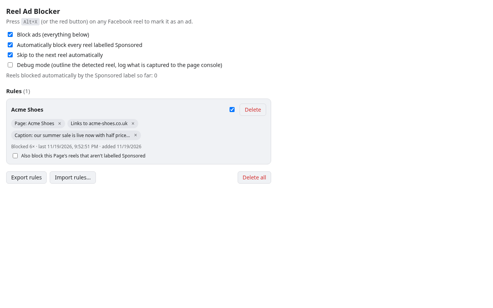

# Reel Ad Blocker for Facebook


Facebook reels labelled **Sponsored** are hidden, muted and skipped automatically. For any ad that
slips through, press one button to say "this is an ad": the extension saves a fingerprint of it and
blocks look-alikes from then on.

Desktop browsers only (Chromium-based and Firefox, via Manifest V3). Everything stays in the
browser's local extension storage; nothing is sent anywhere (see [PRIVACY.md](PRIVACY.md)).



## Install

**Chromium / Chrome / Brave:** `chrome://extensions` → enable *Developer mode* → *Load unpacked* → pick this folder.

**Firefox:** `about:debugging#/runtime/this-firefox` → *Load Temporary Add-on…* → pick `manifest.json`.
Temporary add-ons (and their saved rules) are removed when Firefox closes. Release Firefox only keeps
*signed* extensions, so for a permanent install, sign it as a private ("unlisted") add-on:

1. `npm run package` → `dist/reel-ad-blocker-<version>.zip`
2. Sign in at <https://addons.mozilla.org/developers/addon/submit/distribution>, choose **On your own**
   (private, not listed publicly), upload the zip. Signing is automated and takes a few minutes.
3. Download the signed `.xpi` from the version page, then in Firefox: `about:addons` → gear icon →
   **Install Add-on From File…**.

Each new version needs a higher `version` in `manifest.json` (and `package.json`) before resubmitting, and
installed copies do not auto-update. The manifest declares `data_collection_permissions: none`, which
Mozilla requires of new extensions, and the extension ID in it must be unique across all of AMO.
(Alternative: Firefox Developer Edition / Nightly / ESR with `xpinstall.signatures.required` set to
`false` in `about:config` installs unsigned builds.)

## Use

1. Open a reel (`facebook.com/reel/...`, `/reels/...` or `/watch`).
2. Reels carrying the **Sponsored** label ("Commandité", "Patrocinado", … in your Facebook language) are
   blocked on their own; the banner at the top says so. Turn this off with **Turn off auto-block** in the
   banner or on the manage page.
3. For an ad that wasn't labelled or wasn't caught, click the red **Block this ad** button (bottom right)
   or press **Alt+X**. A toast shows what was captured, with **Undo**. The ad is hidden, paused and skipped.

Skipping is best effort, because Facebook offers no way to ask for the next reel. For each blocked ad the
extension tries up to 8 times, about a second apart, each time with a different method (the on-screen
"next" arrow, scrolling the reel list, the Down-arrow key, a wheel tick, scrolling the next reel into
view), and remembers which method worked. If none does, it gives up on that ad: the banner says
"Couldn't skip it automatically: scroll down to move on", the ad stays hidden and muted, and nothing keeps
retrying in the background.
4. Click the toolbar icon to review rules: toggle, delete, or remove a single signal from a rule (the ×
   on each chip), import/export.

If a rule catches something it shouldn't, the banner at the top of a blocked reel has **Show anyway**
(just this reel) and **Delete rule**.

## How it recognises "the same ad"

Facebook's CSS class names are obfuscated and change constantly, so none are used. A reel is described
by what it *says* and *links to*:

| Signal | Taken from | On its own, blocks future reels that… |
|---|---|---|
| Destination domain | outbound links (unwrapped from `l.facebook.com/l.php?u=…`) | link to the same site. Generic destinations are ignored: app stores, YouTube, URL shorteners, and marketplaces / site builders such as Amazon, eBay, Etsy, Shopify (in every country variant). |
| Caption | first two long text lines, normalised, hashed into word 3-grams | share ≥ 70 % of their phrases (survives truncation, emoji, punctuation). Captions under ~7 words are ignored. |
| Reel id | `/reel/<id>` links inside the reel | are the same reel |
| Advertiser | the first Page/profile link | are from the same Page **and** show a "Sponsored" label or a call-to-action button |

Separately from rules, the **Sponsored label** alone blocks a reel when auto-block is on (the default).
Why the label and not the call-to-action button: of 16 reels marked by hand on real Facebook (French
interface), all 15 ads carried the Sponsored label (and a button), while the 16th was an ordinary Page. The label
is Facebook's own disclosure, so it is the one trigger with no known false positives.

The advertiser rule is deliberately gated: a Page's organic reels share its name with its ads, so the
name alone must not block them. If the reel you flagged had no ad markers at all, the rule is saved as
"block this Page outright" (visible as a checkbox in the manage page) because the gate could never fire.

"Sponsored" is read from *rendered* text (`innerText`), not `textContent`, because Facebook hides decoy
characters inside that word. Labels are recognised in ~20 languages including English, French (incl.
"Commandité"), Spanish, German, Italian, Portuguese, Chinese, Japanese, Korean.

## Files

```
manifest.json     MV3 manifest (Chromium + Firefox)
src/matcher.js    pure fingerprint + matching logic (no DOM; unit-tested in Node)
src/page.js       ALL Facebook-DOM knowledge: finding the reel on screen, collecting its text/links, skipping
src/content.js    button, Alt+X, rule storage, scan loop, toast/banner
src/content.css   blocked-reel style + UI styles
manage.*          toolbar popup / options page
icons/            extension icon (icon.svg is the source of the PNGs)
store/            text and screenshots for the add-on store listing (not part of the package)
test/             unit tests, a mock reel page, and an end-to-end browser test
```

## Tests

```
npm test                 # 23 unit tests of the matching logic (Node only)
npm install && npm run test:e2e
                         # loads the extension in Chromium against test/fixture/reels.html
BROWSER=firefox npm run test:e2e
                         # same, in Firefox (skips the manage-page steps; see next line)
node test/firefox-manage.mjs
                         # manage page in Firefox, via geckodriver (BiDi can't open moz-extension:// pages)
npm run test:hostile     # stress test: the page ignores script input, restarts paused videos, rebuilds
                         # its elements... the extension must never get into an endless loop (also BROWSER=firefox)
```
If Chromium fails with "Socket path too long", run the e2e with a short `TMPDIR`, e.g. `TMPDIR=$PWD/.tmp`.

## What is and isn't verified

Verified: the matching logic (unit tests, including organic-reel and page-chrome false positives), and
the whole extension flow in headless Chromium and Firefox 156 against a **mock** reel page that imitates
the shape of Facebook's (snap-scrolling list, one `<video>` per reel, obfuscated "Sponsored",
`l.facebook.com` links, a "Next card" button), plus the manage page in Firefox.

**Not verified: real facebook.com.** I can't see Facebook's live markup from here, so the
bits in `src/page.js` are educated guesses and the most likely things to need adjusting:

- *Finding the reel wrapper* (largest ancestor holding exactly one `<video>`, stopping at landmark roles).
- *Skipping*: it clicks a button labelled "Next card"/"Next", else sends ArrowDown, else scrolls.
  If skipping doesn't work the ad is still hidden and muted, and the banner stays up.
- Ads shown inside the home-feed reels carousel are not handled (only `/reel`, `/reels`, `/watch`).

To tune it: turn on **Debug mode** in the manage page. The detected reel gets a dashed magenta
outline and each reel's captured fingerprint is logged to the page console (`[reel-ad-blocker]`).
In debug mode the console also logs each `BLOCK`, `UNBLOCK`, `SKIP attempt n/8 via <method>` and `STUCK`,
which shows exactly which skip methods were tried and what happened. Outline wrong → adjust `reelContainer()`. Right outline but empty fields → adjust `collectRaw()` /
`buildFingerprint()`.

## License and disclaimer

[MIT](LICENSE). Not affiliated with, endorsed by, or sponsored by Meta Platforms, Inc.; "Facebook" is
a trademark of Meta Platforms, Inc. Facebook changes its pages often, so expect to adjust `src/page.js`
now and then; issues and pull requests are welcome.
